<a href="https://www.fl0sec.com">
  
</a>

 

  
   
  <a href="https://credentials.offsec.com/79193237">Verify OSCP on OffSec</a> · <a href="https://profile.hackthebox.com/profile/019ec090-47e8-7007-9325-d5131b95ab14">Hack The Box</a> · <a href="https://tryhackme.com/p/Fl0sec">TryHackMe</a>

I'm **Florent**, an offensive security engineer working under **fl0sec**. I write security tooling in C++, reverse Windows software down to the kernel, and build AI agents that automate the repetitive parts of an audit. I also run pentests and red team work on web apps, APIs and Windows.

 

  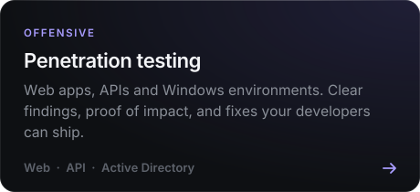
  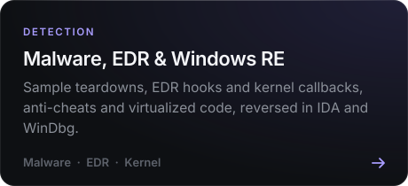

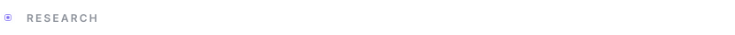

  <a href="https://www.fl0sec.com/research/plutonium-bootstrapper-themida">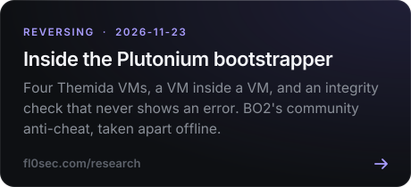</a>
  <a href="https://www.fl0sec.com/research/where-hardware-breakpoint-syscalls-resume">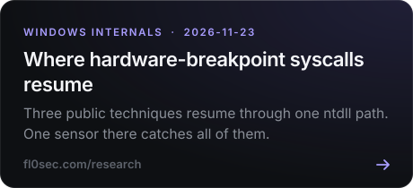</a>

  <a href="https://www.fl0sec.com/research/kernel-anti-cheat-ctf">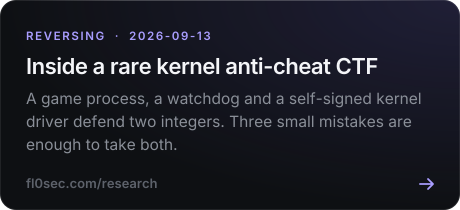</a>
  <a href="https://www.fl0sec.com/research/pivotgate-syscalls-without-stack-fiction">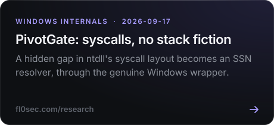</a>

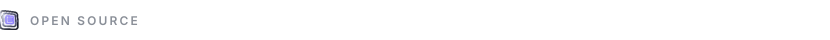

  <a href="https://github.com/Fl0sec/plutonium-devirt">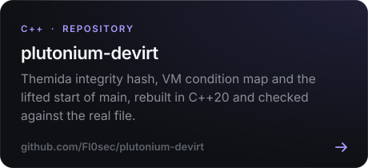</a>
  <a href="https://github.com/Fl0sec/Dr7Watch">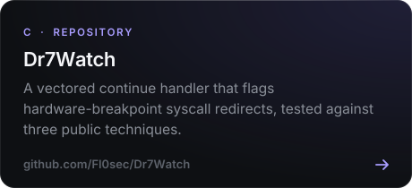</a>

  <a href="https://github.com/Fl0sec/PivotGate">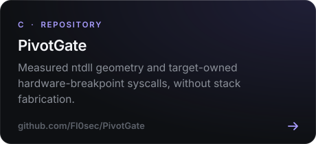</a>
  <a href="https://github.com/Fl0sec/fl0sec-labs">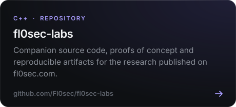</a>

Need a pentest before launch, or a second pair of eyes on something low-level?

  

